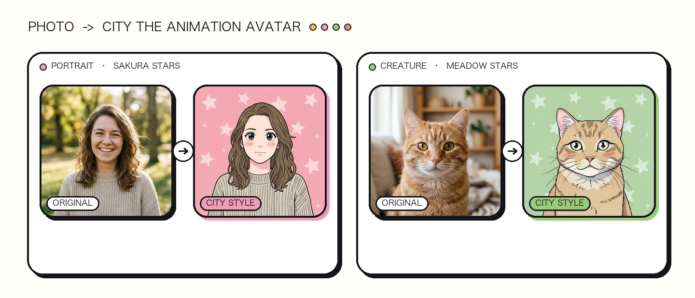
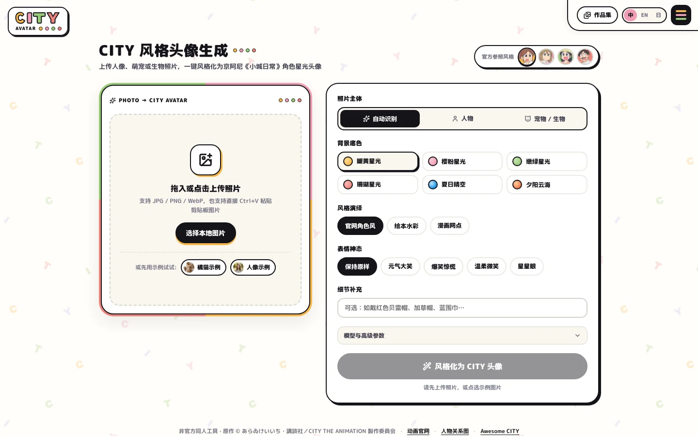

<div align="right">English | <a href="./README.zh.md">简体中文</a></div>

<div align="center">


# CITY Avatar

Turn any photo of a person, pet, or creature into a ***CITY THE ANIMATION*** official-style avatar with Cloudflare Workers AI.

[](LICENSE)


[Live Demo](https://avatar.city.chius.dev) · [CITY Social Map](https://social.city.chius.dev) · [Issues](https://github.com/chius-me/city-avatar/issues) · [Awesome CITY](https://github.com/chius-me/awesome-citytheanimation)

</div>

> Upload a portrait, a cat, or any creature photo and restyle it into the clean flat cel-shaded aesthetic of [`city-the-animation.com/character/`](https://city-the-animation.com/character/).
>
> Live site: **https://avatar.city.chius.dev**





## Features

- **Photo-to-CITY Stylization**: Upload a photo via file picker, drag-and-drop, or instant clipboard paste (`Ctrl+V` / `Cmd+V`), or try the built-in tabby cat and portrait samples.
- **Subject-Aware Conditioning**: Dedicated **Auto**, **Person**, and **Pet / Creature** modes preserve human hair/outfits and keep animals as expressive 2D anime creatures without human-face leakage.
- **Official C-I-T-Y Star & Sky Backdrops**: Choose from the four signature C-I-T-Y pastel five-point star cards (**Marigold `#f7b647`**, **Sakura `#f09cb4`**, **Meadow `#99cb77`**, **Coral `#ee847d`**) plus **Summer Sky** and **Sunset Clouds**, paired with **Official Icon**, **Storybook**, and **Manga Pop** render styles and expression presets.
- **Before/After Slider & Canvas Finishing**: Scrub across an interactive split-screen comparison view, switch between **Rounded**, **Circle**, and **Square** crops, pan/zoom on a crisp `1024×1024` canvas, optionally add CITY frames or captions, and export to PNG, WebP, or clipboard.
- **Local IndexedDB History & Adapted Visual Grammar**: Automatically keeps recent generations in the browser's IndexedDB (`My Gallery` slide-over drawer) and supports **中文 / EN / 日本語** switching inside an interface adapted from [*CITY THE ANIMATION*](https://city-the-animation.com/).

## How It Works

```text
Browser (React + Vite)
  ├── Resize upload to <=768px JPEG + create 180px thumbnail
  ├── POST /api/stylize ──▶ Cloudflare Worker
  │                           ├── Load matched C-I-T-Y star-pattern ref (ASSETS)
  │                           └── Run Workers AI FLUX.2 multipart inference
  │                               (flux-2-klein-4b / flux-2-klein-9b / flux-2-dev)
  └── Real-time 1024×1024 HTML5 Canvas masks, frames, Before/After slider & IndexedDB gallery
```

No server-side database is required. All image preparation, canvas decoration, and creation history live locally in the browser, while the Cloudflare Worker handles multipart image-to-image inference via `env.AI`.

## Development & Deployment

Node.js 22+ and a Cloudflare account (with Workers AI enabled) are required.

```bash
npm install
npm run dev        # Start local Vite + Cloudflare Workers dev server
npm run typecheck  # Run strict TypeScript checks
npm run build      # Type-check & build Worker + client bundle
npm run deploy     # Build and deploy to Cloudflare Workers
```

## Credits & Sources

- **Visual Aesthetic Reference**: [*CITY THE ANIMATION* Official Website](https://city-the-animation.com/) (`city-the-animation.com/character/`).
- **Curated Resources**: [`chius-me/awesome-citytheanimation`](https://github.com/chius-me/awesome-citytheanimation).
- **Sister Project**: [`chius-me/city-social-map`](https://github.com/chius-me/city-social-map) ([`social.city.chius.dev`](https://social.city.chius.dev)).
- **AI Inference**: Cloudflare Workers AI (`@cf/black-forest-labs/flux-2-klein-4b`, `flux-2-klein-9b`, `flux-2-dev`).

## 📄 License

Software source code in this repository is distributed under the [MIT License](LICENSE).

Unofficial fan-made creative tool. Original *CITY* characters, visual design, and intellectual property belong to © Keiichi Arawi · Kodansha / *CITY THE ANIMATION* Production Committee (Kyoto Animation).

---

<div align="center">
  <sub>Crafted with ❤️ by <a href="https://chius.cc">Chius</a> · Powered by Cloudflare & GitHub</sub>
</div>
