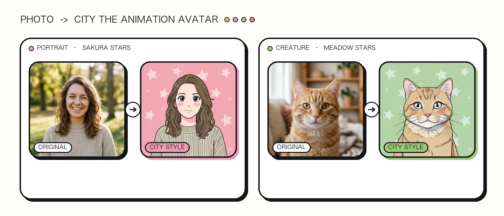
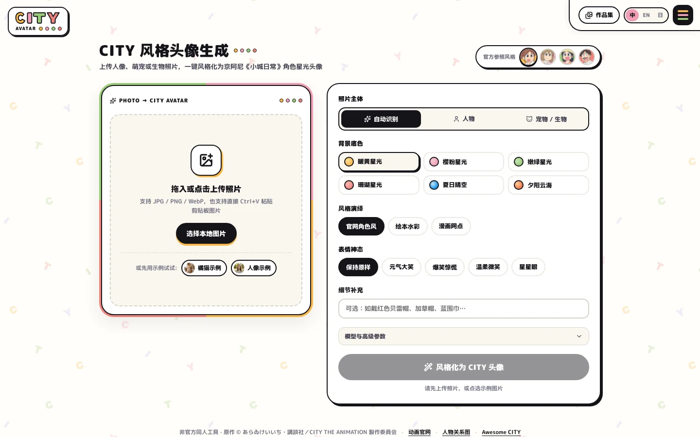

<div align="right"><a href="./README.md">English</a> | 简体中文</div>

<div align="center">


# CITY Avatar · 《小城日常》风格头像工坊

上传任意人物、宠物或生物照片，通过 Cloudflare Workers AI 一键风格化为 ***CITY THE ANIMATION*** 官网角色同款头像。

[](LICENSE)


[在线体验](https://avatar.city.chius.dev) · [CITY 人物关系图](https://social.city.chius.dev) · [问题反馈](https://github.com/chius-me/city-avatar/issues) · [Awesome CITY](https://github.com/chius-me/awesome-citytheanimation)

</div>

> 上传自拍、人像、猫咪或其他任意生物照片，一键重绘为京都动画 [`city-the-animation.com/character/`](https://city-the-animation.com/character/) 角色卡风格的明快扁平赛璐珞头像。
>
> 在线访问：**https://avatar.city.chius.dev**





## 功能亮点

- **任意照片风格化**：支持点击选择、拖拽上传与剪贴板直接粘贴（`Ctrl+V` / `Cmd+V`），并内置「橘猫」「人像」两款示例一键体验。
- **主体感知保护**：区分 **自动识别**、**人物** 与 **宠物 / 生物** 三种模式；在保留人物发型与穿搭神韵的同时，防止动物照片在风格迁移时出现人脸特征串扰。
- **官方 C-I-T-Y 星光与晴空底色**：提供标志性的四色五角星底色（**暖黄 `#f7b647`**、**樱粉 `#f09cb4`**、**嫩绿 `#99cb77`**、**珊瑚 `#ee847d`**）以及 **夏日晴空**、**夕阳云海**，并支持 **官网角色风**、**绘本水彩**、**漫画网点** 风格与多种神态微调。
- **滑动对比与画布精修**：生成后可切换 **滑动对比** 查看原图与成图差异，支持 **圆角 / 圆形 / 方形** 裁切、画布拖拽缩放、`CITY` 装饰画框与签名气泡叠加，一键导出 `1024×1024` PNG、WebP 或复制到剪贴板。
- **本地相册 & 三语界面**：生成作品自动存入浏览器 IndexedDB（右侧滑出式 `作品集`），界面语言源自 [《CITY THE ANIMATION》官方网站](https://city-the-animation.com/) 美学适配，支持 **中文 / EN / 日本語** 即时切换。

## 工作原理

```text
浏览器前端 (React + Vite)
  ├── 压缩上传图片至 <=768px JPEG，并生成 180px 本地缩略图
  ├── POST /api/stylize ──▶ Cloudflare Worker
  │                           ├── 读取匹配的 C-I-T-Y 星光底纹参照 (ASSETS)
  │                           └── 调用 Workers AI FLUX.2 多图参考推理
  │                               (flux-2-klein-4b / flux-2-klein-9b / flux-2-dev)
  └── 1024×1024 HTML5 Canvas 实时裁切画框、前后对比滑块与 IndexedDB 本地历史
```

无需外部数据库：所有前端图片预处理、画布修饰和历史存档均在浏览器本地完成，Cloudflare Worker 负责通过 `env.AI` 执行 multipart 图生图风格化推理。

## 本地开发与部署

需要 Node.js 22+ 与已开通 Workers AI 的 Cloudflare 账号。

```bash
npm install
npm run dev        # 启动 Vite + Cloudflare Workers 本地开发服务
npm run typecheck  # 执行严格 TypeScript 检查
npm run build      # 类型检查并构建 Worker 与前端产物
npm run deploy     # 构建并部署至 Cloudflare Workers
```

## 参考与致谢

- **视觉风格参考**：[《CITY THE ANIMATION》官方网站](https://city-the-animation.com/)（`city-the-animation.com/character/`）。
- **精选资料清单**：[`chius-me/awesome-citytheanimation`](https://github.com/chius-me/awesome-citytheanimation)。
- **姊妹项目**：[`chius-me/city-social-map`](https://github.com/chius-me/city-social-map)（[`social.city.chius.dev`](https://social.city.chius.dev)）。
- **AI 模型支持**：Cloudflare Workers AI（`@cf/black-forest-labs/flux-2-klein-4b`、`flux-2-klein-9b`、`flux-2-dev`）。

## 📄 许可证

本仓库软件源代码采用 [MIT 许可证](LICENSE) 开源。

本项目为非官方粉丝创作工具。原作《CITY》及《CITY THE ANIMATION》角色设定、视觉版权归 © あらゐけいいち・講談社／CITY THE ANIMATION 製作委員会所有。

---

<div align="center">
  <sub>Crafted with ❤️ by <a href="https://chius.cc">Chius</a> · Powered by Cloudflare & GitHub</sub>
</div>
